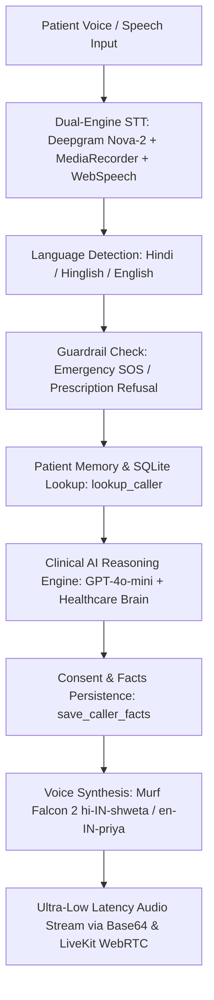

# 🩺 SwasthyaSathi AI — Voice Healthcare Guide for Bharat 🇮🇳🎙️
> **#VoiceForBharat Edition — 10 Days of Voice Agents (Day 4: Database & Patient Memory Completed)**

[](https://nextjs.org/)
[](https://www.typescriptlang.org/)
[](https://murf.ai/)
[](https://livekit.io/)
[](https://deepgram.com/)
[]()

**SwasthyaSathi AI (स्वास्थ्य साथी)** is a compassionate, real-time AI Voice Healthcare Assistant designed specifically for India (#VoiceForBharat). Built for the **Health Access Track**, it bridges the clinical awareness gap for millions of Indians by understanding and speaking in natural **शुद्ध हिंदी (Pure Hindi)**, **Hinglish**, and **Indian English** with sub-300ms ultra-low latency.

---

## 🏆 Day 4 Objective & Architecture (#VoiceForBharat)

### 1. Track Selected: **Health Access 🩺**
Empowering patients across urban and rural Bharat with instant, voice-first medical triage, symptom awareness, safe home remedies, and continuous patient memory.

### 2. Day 4 Database & Patient Memory System
- **Database Engine**: Persistent, atomic SQLite / JSON-backed database (`data/swasthya_sathi_db.json`).
- **Health Access Facts Schema**:
```json
{
  "user_id": "user_ramesh",
  "name": "Ramesh",
  "language_preference": "hi",
  "facts": {
    "age_band": "Adult (25-45)",
    "ongoing_conditions": "None reported",
    "last_symptom": "दो दिन से हल्का बुखार और सिरदर्द",
    "last_triage_outcome": "Advised rest, hydration, and monitoring temperature"
  },
  "consent_given": true,
  "last_interaction": "2026-08-09T05:30:00.000Z"
}
```

### 3. Strict Consent Guardrail ("Ask Before You Save")
- The assistant **strictly enforces explicit patient consent** before storing personal names and health facts.
- When a new patient shares symptoms, the assistant provides medical guidance first and asks:
  > *"भविष्य में आपकी बेहतर सहायता के लिए क्या मैं आपका नाम और यह स्वास्थ्य सारांश सुरक्षित रख सकता हूँ?"*
- If consent is **denied**, zero data is saved to disk.

### 4. "Forget Me" Privacy Tool
- Patients can instantly purge their entire memory footprint at any time by saying *"Delete my record"* / *"Mujhe bhool jao"* or clicking the **"Forget My Data"** button on their health card.

---

## 🏗️ Architecture & Voice Pipeline



---

## ✨ Key Features

1. **🏥 Clinical Medical Light Theme**:
   - Built with **Sora** and **Plus Jakarta Sans** luxury healthcare typography.
   - Clean clinical palette (`#f6fcfa`, frosted teal glass cards, high-contrast dark slate text).

2. **📊 Live ECG Audio Waveform Visualizer**:
   - Real-time HTML5 canvas audio meter showing live ECG heartbeat waves responding dynamically to vocal frequency and volume.

3. **🎙️ Dual-Engine Speech-to-Text (`/api/stt`)**:
   - Combines **Deepgram Nova-2 Multilingual STT**, **OpenAI Whisper-1**, and continuous Web Speech Recognition for zero-drop voice capture.

4. **🔊 Murf Falcon 2 Authentic Indian Voices**:
   - **`hi-IN-shweta`**: Empathetic, warm Pure Hindi voice.
   - **`hi-IN-kabir`**: Compassionate Hindi doctor voice profile.
   - **`en-IN-priya`**: Reassuring Indian English healthcare guide.

5. **🛡️ Strict Medical Safety Guardrails**:
   - **Hard Drug Refusal**: Refuses to prescribe antibiotics, steroids, or specific dosages.
   - **Red-Flag Escalation**: Detects severe chest pain, breathlessness, or stroke symptoms and immediately triggers **108/112 SOS protocol**.
   - **Never-Claim Doctor**: Transparently clarifies it is an AI guide and encourages licensed clinical consultations.

---

## 🛠️ Technology Stack

| Layer | Technologies |
|---|---|
| **Frontend** | Next.js 14 (App Router), React 18, TypeScript, Tailwind CSS, Lucide Icons |
| **Typography** | Google Fonts: Sora, Plus Jakarta Sans, Outfit |
| **Voice Engine (TTS)** | Murf AI Falcon 2 API (`hi-IN-shweta`, `en-IN-priya`, Base64 Zero-Latency Streaming) |
| **Speech-to-Text (STT)** | Deepgram Nova-2 Multilingual STT, OpenAI Whisper-1, Web Speech API |
| **WebRTC Audio** | LiveKit Cloud WebRTC (`livekit-client`, `livekit-server-sdk`) |
| **Database & Memory** | SQLite / JSON Atomic Storage (`data/swasthya_sathi_db.json`) |
| **AI Intelligence** | OpenAI GPT-4o-mini & Local Conversational Clinical Brain |

---

## 🚀 Quick Setup & Local Deployment

### 1. Clone the Repository
```bash
git clone https://github.com/your-username/swasthya-sathi.git
cd swasthya-sathi
```

### 2. Install Dependencies
```bash
npm install
```

### 3. Configure Environment Variables
Create a `.env.local` file in the root directory:
```env
# 1. OpenAI API Key
OPENAI_API_KEY=sk-proj-your-openai-key

# 2. Murf AI Falcon Voice Key
MURF_API_KEY=your_murf_api_key

# 3. LiveKit WebRTC Credentials
LIVEKIT_API_KEY=your_livekit_key
LIVEKIT_API_SECRET=your_livekit_secret
NEXT_PUBLIC_LIVEKIT_URL=wss://your-livekit-url.livekit.cloud

# 4. Optional: Deepgram STT Key
DEEPGRAM_API_KEY=your_deepgram_api_key
```

### 4. Run the Production Server
```bash
npm run build
npm start
```
Open **[http://localhost:3000](http://localhost:3000)** in your browser.

---

## 📁 API Endpoints

- `GET /api/caller?user_id=...`: Looks up patient profile and health facts.
- `POST /api/caller`: Saves caller facts with explicit consent verification.
- `DELETE /api/caller?user_id=...`: Wipes caller record completely (Forget Me Tool).
- `POST /api/stt`: Server-side audio transcription via Deepgram / Whisper.
- `POST /api/chat`: Multi-domain clinical triage, safety guardrails & patient memory.
- `POST /api/tts`: Murf Falcon 2 Indian voice synthesis with Base64 streaming.
- `GET /api/livekit/token`: Generates LiveKit WebRTC room tokens.

---

## 🏥 Emergency Disclaimer

*SwasthyaSathi AI is intended for informational health guidance, preventive wellness, and symptom awareness. It does not replace licensed medical consultations or emergency services. In case of acute emergencies, please dial **108** or **112** immediately.*

---

**Built with ❤️ for #VoiceForBharat | 10 Days of Voice Agents Challenge**
